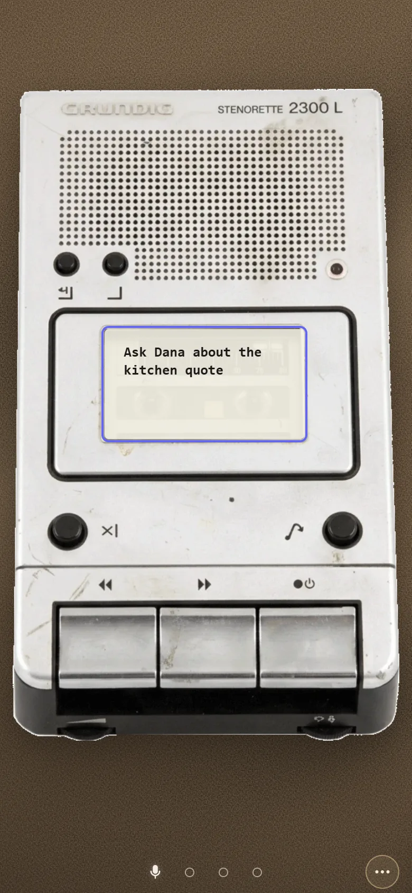
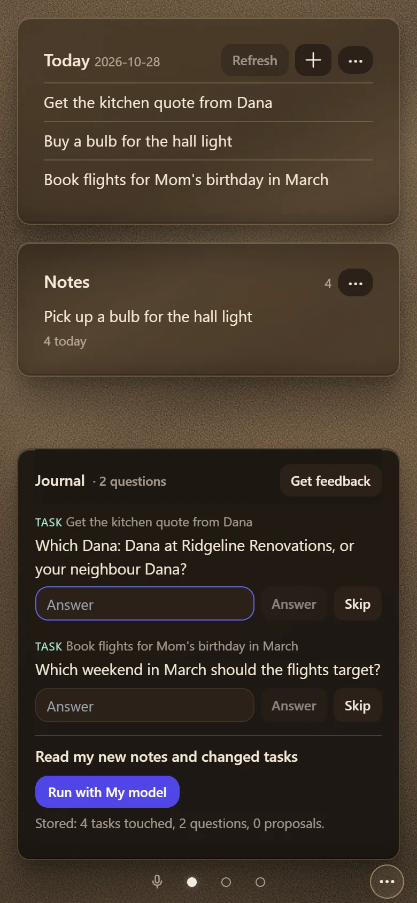
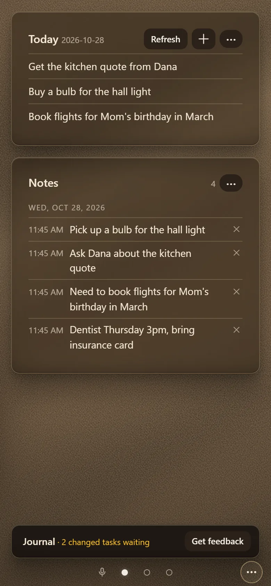
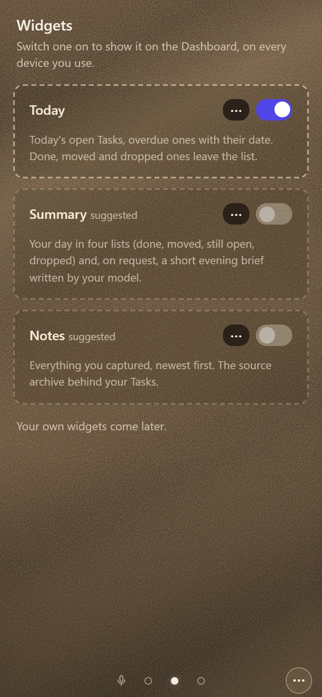
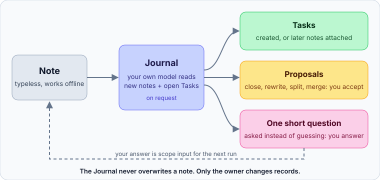

# Planner

A local-first personal planner for the phone. You write things down without stopping to organise them. An AI
**Journal** then reads the notes, turns them into **Tasks**, and asks a short question whenever it would otherwise have
to guess. **Today** shows what is due.

It is built and used daily by one person, for their own needs, and kept open source as a working example of an AI
product with clear limits: the AI reads, proposes and asks, and only the owner changes records.

> **Status:** in daily use by its author, with an invite-only alpha. Not a hosted service: there is no sign-up.
> You can run your own copy (see [Self-hosting](#self-hosting)).

<table>
  <tr>
    <td align="center" width="25%"><br><sub><b>Capture</b><br>write it down, nothing to file</sub></td>
    <td align="center" width="25%"><br><sub><b>Journal</b><br>reads the notes, asks instead of guessing</sub></td>
    <td align="center" width="25%"><br><sub><b>Today</b><br>the Tasks that came out of the notes</sub></td>
    <td align="center" width="25%"><br><sub><b>Widgets</b><br>switch on what you want to see</sub></td>
  </tr>
</table>

<sub>Screenshots are from a local build with invented notes and a stand-in model, not from a real account.</sub>

## How a note becomes a Task



## What it does

- **Capture first.** Notes are typeless: no form, no category, no intent to pick. Capture works offline and never waits
  on the network: a note and its outbox row commit in one IndexedDB transaction.
- **The Journal.** On request, your chosen model reads new and reopened notes along with the open Tasks. It creates Tasks,
  attaches later notes to existing ones, and *proposes* closes, rewrites, splits and merges. It never overwrites text you
  wrote. A note it can't read with certainty (a misspelt name, a vague date) gets one short question; it is never
  corrected silently.
- **Questions.** Listed in the Journal strip, each answered in one line. An answer is scope input: the next run can split
  or re-scope the Task it was about.
- **Today and widgets.** Today lists your open Tasks, overdue ones with their date. More widgets (a summary per horizon,
  a notes archive) can be switched on per account, and every device shows the same Dashboard.
- **Bring your own model.** Register Claude, GPT, Gemini, OpenRouter or any OpenAI-compatible endpoint with your own
  API key. The key is encrypted on the server (AES-GCM) and never sent back to a device. Each call runs as a Cloudflare
  Workflow, so a slow reply is not lost when the phone sleeps. Calls are capped per day.
- **Sync across devices.** The server orders every change with a per-account counter. A stale edit keeps the text it
  replaced as a revision, and a delete is never resurrected by an older device.

## How it is built

| Layer | Stack |
|---|---|
| App (PWA) | Vue 3, Pinia, Vue Router, Tailwind, Dexie 4 (IndexedDB), Workbox; hosted on Cloudflare Pages |
| Backend | Cloudflare Worker with Hono, D1 (SQLite), Workflows for model calls, the rate-limiting binding |
| Shared | `src/domain/`: environment-free validation, cleaning and prompt composition, imported by both the app and the Worker |
| Auth | Own OAuth code for GitHub and Google (PKCE), invite-only accounts, opaque bearer sessions |
| Tests | Vitest for the app; the Worker tests run in workerd against a fresh D1 per test (`@cloudflare/vitest-plugin`) |

Some rules the code holds to, each with the place it is enforced (full list in
[docs/ARCHITECTURE.md](docs/ARCHITECTURE.md)):

- **Provenance:** AI output never becomes an entry. It lives in reports and proposals until the owner accepts it.
- **Tenant isolation:** the backend takes the account from the session, never from a request body, and every query
  goes through one data-access module that requires it. Tests check this with two accounts holding the same ids.
- **Checks that can fail:** behaviour tests are written with a negative control, the change that must make them fail,
  and the design docs record which controls were caught.

## Documentation

The design is documented as it was decided:

- [docs/PROJECT.md](docs/PROJECT.md): vision, tiers and the decision log
- [docs/DECISION-TREE.md](docs/DECISION-TREE.md): every decision (`D-nn`), with its options, the recommendation and re-entry conditions
- [docs/VOCABULARY.md](docs/VOCABULARY.md): one word per concept, used alike in UI, code and docs
- [docs/HW-HARNESS.md](docs/HW-HARNESS.md) and [docs/H5-MODELS.md](docs/H5-MODELS.md): the Journal and bring-your-own-model
- [docs/RUNBOOK.md](docs/RUNBOOK.md): run, test, deploy, restore

## Running locally

Requires Node 24 (as CI uses) and pnpm.

```bash
pnpm install
pnpm --dir api install
pnpm check
```

`pnpm check` runs the type checks, the app tests and the Worker tests, offline. For the dev servers and local sign-in
(an invite in the local D1), see [docs/RUNBOOK.md](docs/RUNBOOK.md) §Local.

## Self-hosting

Possible on Cloudflare's free plan, but not yet packaged: the steps below have only been walked by the author.

1. A Cloudflare account: create a D1 database and put its id in `api/wrangler.toml`. Set `ALLOWED_APP_URLS` to your
   app's URL, and create the Pages project the app deploys to (`.github/workflows/deploy.yml`).
2. A GitHub OAuth App and/or a Google OAuth client, whose callback is `<worker-url>/auth/callback/<provider>`.
3. Worker secrets: `GITHUB_CLIENT_ID`, `GITHUB_CLIENT_SECRET`, `GOOGLE_CLIENT_ID`, `GOOGLE_CLIENT_SECRET` and
   `MODEL_KEY_SECRET` (32 random bytes, base64; it encrypts the stored model keys, and changing it makes every stored key
   unreadable).
4. `pnpm --dir api run deploy` applies the migrations and deploys the Worker. Then invite yourself with
   `node api/scripts/invite.mjs create <email> --remote`.

## License

[MIT](LICENSE)
